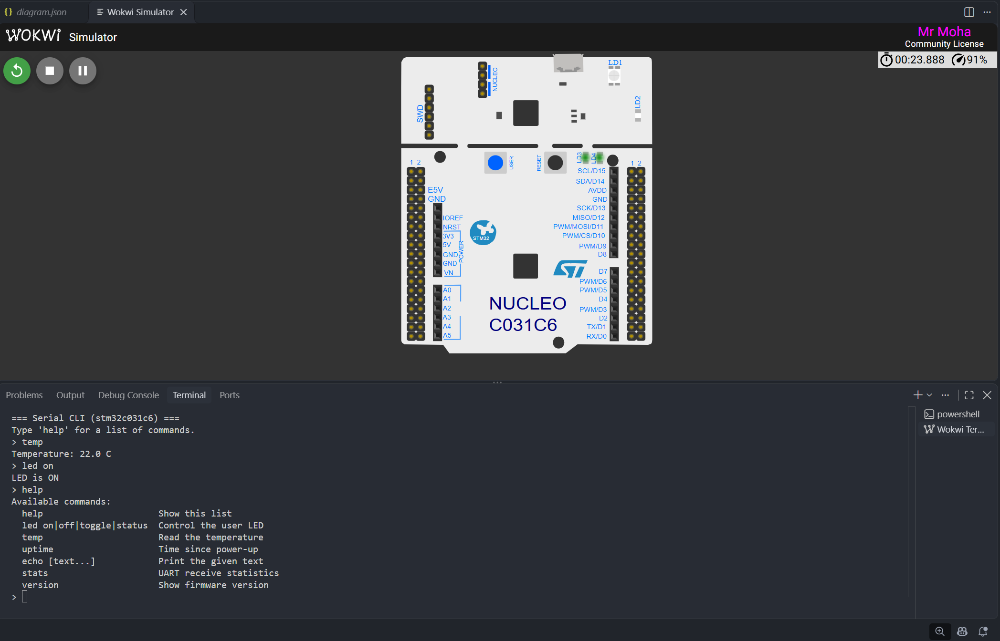

# STM32 Serial CLI


A small command-line interface for a microcontroller's serial port, written in C
for the **STM32C031C6** (Cortex-M0+). Type commands such as `led on`, `temp` or `help`
into a serial terminal and the firmware answers.

It is written without any vendor library: the register access, start-up code and linker
script are all in this repository. The command-line logic itself is **hardware-independent**,
so it is unit-tested on a PC and also runs there in a normal terminal.

## Demo
   
A real session, from the PC build (`make run`):

```text
=== Serial CLI (host) ===
Type 'help' for a list of commands.
> help
Available commands:
  help                      Show this list
  led on|off|toggle|status  Control the user LED
  temp                      Read the temperature
  uptime                    Time since power-up
  echo [text...]            Print the given text
  stats                     UART receive statistics
  version                   Show firmware version
> led on
LED is ON
> temp
Temperature: 20.0 C
> echo hello embedded world
hello embedded world
> led blink
usage: led on|off|toggle|status
> foo
error: unknown command 'foo' (type 'help')
> version
Serial CLI firmware v1.0.0 (host)
```

## Features

- **Interrupt-driven receive.** The UART interrupt only stores the byte and returns. The
  main loop does the real work, so slow printing never blocks the interrupt.
- **Lock-free ring buffer** between the interrupt and the main loop (single producer,
  single consumer, power-of-two size, free-running indices).
- **Table-driven commands.** Adding a command means writing one function and adding one
  row to a table. `help` is generated from that table, so it can never go out of date.
- **Line editing:** backspace, `Ctrl+C` to cancel, arrow-key escape codes ignored,
  `\r`, `\n` and `\r\n` all accepted as Enter.
- **Safe input handling:** unknown commands, wrong arguments, too many words and
  over-long lines are all reported instead of crashing or overflowing a buffer.
- **No dynamic memory and no `printf`.** All buffers have a fixed size known at compile time.
- **Portable design:** a small hardware abstraction layer (`core/hal.h`) separates the
  logic from the chip. The same code runs on STM32, on a PC and inside the unit tests.
- **Small:** about 4 KB of flash and under 200 bytes of static RAM (plus the stack) for the
  whole firmware.

## How it works

```text
  UART RX interrupt                          main loop
 +------------------+   rb_push   +-------------+   rb_pop   +------------+   +---------------+
 | USART2_IRQHandler| ----------> | ring buffer | ---------> | CLI parser | ->| command table |
 +------------------+             +-------------+            +------------+   +---------------+
                                                                    |
                                                          hal_uart_write()  -> serial port
```

1. A byte arrives on the UART. `USART2_IRQHandler` calls `app_on_rx_byte()`, which pushes it
   into the ring buffer. If the buffer is full the byte is dropped and counted (`stats`).
2. The main loop calls `app_poll()`, which pops every waiting byte and gives it to
   `cli_feed()`.
3. `cli_feed()` edits the current line. On Enter the line is split into words and the first
   word is looked up in the command table.
4. The matching handler runs and prints its answer through `hal_uart_write()`.

Everything above the HAL line is plain C with no hardware access, which is why it can be
tested on a PC.

## Project structure

```text
stm32-serial-cli/
├── core/                    portable code, no hardware access
│   ├── ring_buffer.c/.h     lock-free byte FIFO
│   ├── cli.c/.h             line editor, tokenizer, command dispatcher
│   ├── commands.c/.h        the command table and every command handler
│   ├── app.c/.h             connects the UART receive path to the CLI
│   ├── hal.h                the interface each platform must implement
│   └── temp_sim.c/.h        simulated temperature source
|
├── docs/
|   ├── demo.png
|
├── platform/
│   ├── stm32c0/             STM32C031C6 (Nucleo-C031C6 and the Wokwi simulator)
│   │   ├── hal_stm32c0.c    GPIO, USART2, SysTick and interrupt handlers
│   │   ├── stm32c0_regs.h   register addresses and bit definitions
│   │   ├── startup.c        vector table and Reset_Handler
│   │   ├── linker.ld        flash / RAM memory layout
│   │   └── main.c
│   └── host/                run the same CLI in a PC terminal
│       ├── hal_host.c
│       └── main_host.c
├── tests/                   unit tests (run on the PC)
│   ├── test_ring_buffer.c
│   ├── test_cli.c
│   ├── test_app.c
│   ├── fake_hal.c/.h        fake hardware that records the output
│   └── test_framework.h
├── .github/workflows/ci.yml builds and tests on every push
├── Makefile
├── diagram.json             Wokwi circuit (Nucleo-C031C6 board)
├── wokwi.toml               Wokwi: which firmware to load
├── LICENSE
└── README.md
```

## Getting started

### 1. Run it on your PC

You need `gcc` (or `clang`) and `make`.

```bash
make run
```

Type commands and press Enter. Press `Ctrl+D` to quit.

### 2. Run the unit tests

```bash
make test
```

The tests are compiled with AddressSanitizer and UndefinedBehaviorSanitizer, so memory
errors and undefined behaviour fail the build.

### 3. Build the STM32 firmware

You need the Arm GNU toolchain (`arm-none-eabi-gcc`). On Ubuntu or Debian:

```bash
sudo apt install gcc-arm-none-eabi libnewlib-arm-none-eabi
make stm32
```

This produces `build/stm32/firmware.elf` and `build/stm32/firmware.bin`.

### 4. Run it in the Wokwi simulator

1. Install [Visual Studio Code](https://code.visualstudio.com/) and the **Wokwi Simulator**
   extension.
2. In VS Code press `F1` and run **Wokwi: Request a Free License** (one time).
3. Build the firmware with `make stm32`.
4. Press `F1` and run **Wokwi: Start Simulator**.
5. Type commands into the Wokwi serial monitor.

`led on` and `led off` switch the Nucleo board's green user LED (LD4, pin PA5).

### 5. Run it on a real Nucleo-C031C6 board

Flash `build/stm32/firmware.bin` with STM32CubeProgrammer (or copy it to the board's USB
drive). Then open the board's virtual COM port in a serial terminal (PuTTY, Tera Term,
`screen`, ...) at **115200 baud, 8 data bits, no parity, 1 stop bit**.

## Commands

| Command | What it does |
|---|---|
| `help` | List all commands (generated from the command table) |
| `led on` / `off` / `toggle` / `status` | Control the user LED |
| `temp` | Print the temperature in °C (currently a simulated sensor, see below) |
| `uptime` | Time since power-up as `Xh Ym Zs` |
| `echo [text...]` | Print the given words |
| `stats` | Receive buffer size and how many bytes were dropped |
| `version` | Firmware version and platform name |

## Adding a command

Write a handler in `core/commands.c`:

```c
static int cmd_hello(cli_t *cli, int argc, char *argv[])
{
    (void)argv;
    if (argc != 1) {
        return CLI_ERR_USAGE;      /* the CLI prints "usage: ..." for you */
    }
    cli_puts(cli, "Hello!\r\n");
    return CLI_OK;
}
```

then add one row to the table:

```c
{ "hello", "hello", "Say hello", cmd_hello },
```

`help` picks it up automatically.

## Design decisions

- **Ring buffer instead of processing in the interrupt.** Interrupt handlers should be short.
  Decoupling receive from processing also means a long command cannot cause lost bytes
  (up to the buffer size).
- **Free-running indices and a power-of-two size.** `head - tail` is always the number of
  stored bytes, even after the counters wrap, so the buffer needs no extra "empty slot" and
  no modulo or division. A unit test starts the counters just below `SIZE_MAX` to prove
  the wrap-around works.
- **No locks.** The interrupt writes only `head`, the main loop writes only `tail`. On a
  single-core CPU that is enough, as long as the data is written before the index is
  published (the storage is declared `volatile` to keep that order).
- **A hardware abstraction layer.** `core/` never includes a chip header. That is what lets
  the same code run on STM32, on a PC, and in the tests with a fake HAL.
- **Registers written by hand.** The project has no dependency on ST's HAL or CMSIS. This
  keeps the build tiny and makes it clear exactly what each line does to the hardware.
- **Echo handled by the firmware.** A serial terminal does not echo what you type, so the
  STM32 build echoes characters itself. The PC build turns echo off because the terminal
  already shows them.

## Limitations and next steps

- `temp` uses a **simulated sensor** (a slow 20 to 26 °C wave from `core/temp_sim.c`). Replace
  `hal_temp_read()` in `hal_stm32c0.c` with a real reading (ADC internal sensor, NTC
  thermistor, I2C sensor) and nothing else changes.
- Transmit is blocking (it waits for each byte). An interrupt- or DMA-driven transmit buffer
  would be the next step.
- The main loop busy-waits. Sleeping with `WFI` between events would save power.
- No command history or tab completion.
- The clock is left at its reset default; the baud rate is calculated from it at start-up.

## License

MIT. See [LICENSE](LICENSE).
